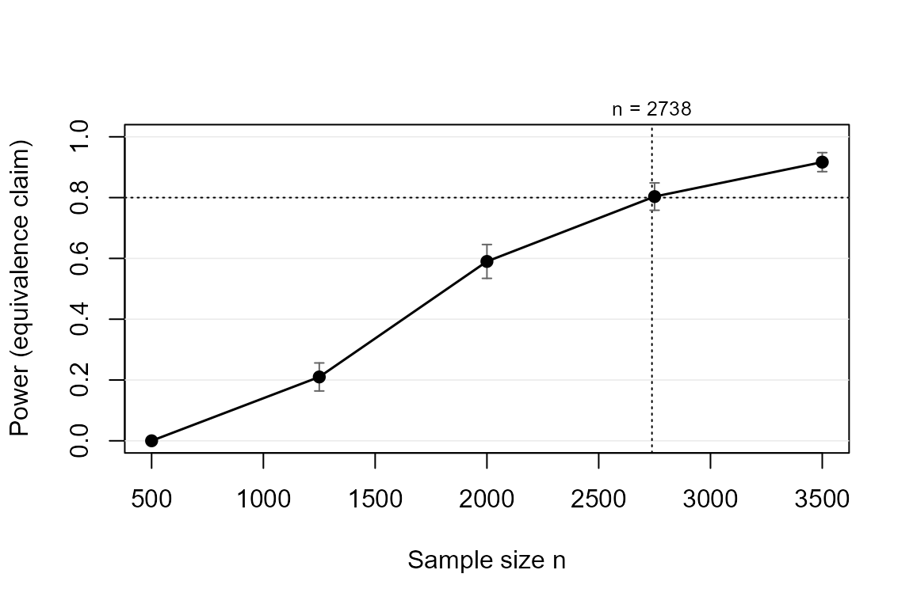

# Powering for equivalence: showing an effect is too small to matter

## The claim

Sometimes the research goal is to show an effect is *negligible*: a
cheaper treatment is not meaningfully worse, a feared side effect is not
meaningfully present. The equivalence claim succeeds when the whole
confidence interval lies inside (-SESOI, +SESOI). A non-significant test
is **not** evidence of absence; a CI inside the equivalence bounds is.

- R
- Stata

``` r

library(powerape)

d <- ape_dgp(model = "probit",
             focal = pa_var("treat", "binary", p = 0.5),
             covariates = list(pa_var("age", "normal", mean = 45, sd = 12)),
             baseline = 0.30, signal = 0.10)
d <- set_ape(d, target = 0)    # planning value: no effect at all
```

``` stata
powerape dgp d, focal(treat, binary p(0.5))                               ///
    covariates((age, normal mean(45) sd(12))) baseline(0.30) signal(0.10)
powerape setape d, target(0)
```

The coherence guard requires \|target\| \< SESOI: you cannot power for
equivalence while assuming a true effect on or beyond the bounds.

## Power and required n

- R
- Stata

``` r

ape_power(d, n = 2000, claim = "equivalence", sesoi = 0.05,
          nsim = 600, seed = 1)
#> powerape -- equivalence claim (CI within +/-0.050)
#>   probit, n = 2000, assumed true APE +0.0000, 90% CI (alpha = 0.05), nsim = 600
#>   power = 0.628 (MCSE 0.020)
#>   outcomes: minimum 0.000 | detect-only 0.018 | inconclusive 0.353 | equivalence 0.628 | failed 0.000
```

``` stata
powerape power d, n(2000) claim(equivalence) sesoi(0.05) nsim(600) seed(1)
```

``` stata-output
powerape -- equivalence claim (CI within +/-0.050)
  probit, n = 2000, assumed true APE + 0.0000,     90% CI (alpha = .05), nsim = 600
  fit: probit via engine(stata), effects(closed)
  power = 0.605 (MCSE 0.020)
  outcomes: minimum 0.000 | detect-only 0.028 | inconclusive 0.367 | equivalence 0.605 | failed 0.000
```

- R
- Stata

``` r

ape_n(d, power = 0.80, claim = "equivalence", sesoi = 0.05,
      nsim = 500, seed = 2)
#> powerape required sample size -- equivalence claim
#>   n = 2705 for 80% target power (confirmed 0.805, MCSE 0.009)
#>   assumed true APE +0.0000, sesoi 0.050, 90% CI (alpha = 0.05), probit
#>   search: 1 step(s); confirmed in 1 round(s) at nsim = 2000.
```

``` stata
powerape n d, power(0.80) claim(equivalence) sesoi(0.05)                 ///
    nsim(500) seed(2) engine(mata)
```

``` stata-output
powerape required sample size -- equivalence claim
  n = 2705 for 80% target power (confirmed 0.799, MCSE 0.009)
  assumed true APE + 0.0000, sesoi 0.050,     90% CI (alpha =    .05), probit
  fit: Mata engine (Fisher scoring)
  search: 1 step(s); confirmed in 1 round(s) at nsim = 2000.
```

Equivalence needs the CI to be *narrow*, not just centered near zero, so
sample sizes are driven entirely by the SESOI: halving the SESOI roughly
quadruples the required n.

- R
- Stata

``` r

cv <- ape_curve(d, n = seq(500, 3500, by = 750), claim = "equivalence",
                sesoi = 0.05, nsim = 300, seed = 3)
plot(cv, target_power = 0.80)
```



``` stata
powerape curve d, n(500(750)3500) claim(equivalence) sesoi(0.05)         ///
    nsim(300) seed(3) engine(mata)

matrix C = r(results)
svmat C, names(col)
twoway connected power n, yline(0.8, lpattern(dash))                      ///
    ytitle("Power") xtitle("Sample size") ylabel(0(0.2)1)
```

``` stata-output
powerape power curve -- equivalence claim, probit (APE), nsim = 300 per point
  fit: Mata engine (Fisher scoring)

         n     alpha    power     mcse   failed  separated
       500    0.0500   0.0000   0.0000   0.0000     0.0000
      1250    0.0500   0.2800   0.0259   0.0000     0.0000
      2000    0.0500   0.5867   0.0284   0.0000     0.0000
      2750    0.0500   0.7933   0.0234   0.0000     0.0000
      3500    0.0500   0.8767   0.0190   0.0000     0.0000
```

![Power of the equivalence claim at sample sizes from 500 to
3,500.]()

## A robustness note

The width of the CI for an APE depends on the baseline rate (binomial
variance peaks at 0.5), so equivalence power inherits that dependence.
[`ape_robust()`](https://jespernwulff.github.io/powerape/reference/ape_robust.md)
makes it visible:

- R
- Stata

``` r

ape_robust(d, n = 2600, claim = "equivalence", sesoi = 0.05,
           vary = list(baseline = c(0.20, 0.50)), grid_points = 3,
           nsim = 300, seed = 4, nmax = FALSE)
#> powerape robustness sweep -- equivalence claim, APE, pin = ape
#>   n = 2600, nsim = 300 per scenario, 3 scenario(s) over: baseline
#>   power range [0.703, 0.903]; worst scenario:
#>  baseline implied_effect     power       mcse separated
#>       0.5              0 0.7033333 0.02637269         0
#>   scenarios:
#>  baseline implied_effect     power       mcse separated
#>      0.20              0 0.9033333 0.01706089         0
#>      0.35              0 0.7233333 0.02582778         0
#>      0.50              0 0.7033333 0.02637269         0
```

``` stata
powerape robust d, n(2600) claim(equivalence) sesoi(0.05)                 ///
    vary(baseline(0.20 0.50)) gridpoints(3) nsim(300) seed(4) nonmax engine(mata)
```

``` stata-output
powerape robustness sweep -- equivalence claim, APE, pin = ape
  n = 2600, nsim = 300 per scenario, 3 scenario(s) over: baseline
  power range [0.663, 0.900]; worst scenario: row 3
  fit: Mata engine (Fisher scoring)
 row     baseline    implied_eff    power     mcse separated
   1           .2         0.0000   0.9000   0.0173    0.0000
   2          .35         0.0000   0.7200   0.0259    0.0000
   3           .5         0.0000   0.6633   0.0273    0.0000
```

## Reporting

[`power_statement()`](https://jespernwulff.github.io/powerape/reference/power_statement.md)
works for equivalence designs too, and states the error-rate convention
explicitly: the equivalence claim is a TOST at `alpha = .05`, read off
the 90% interval (Lakens, 2017; Riesthuis, 2024), the same convention
TOSTER uses. The conservative alternative of a 95% interval (a TOST at
2.5%) is available via `conf = 0.95`.

- R
- Stata

``` r

pw <- ape_power(d, n = 2600, claim = "equivalence", sesoi = 0.05,
                nsim = 500, seed = 5)
power_statement(pw)
#> We conducted a simulation-based power analysis for the average partial effect
#> (APE) of treat using the powerape package (version 1.11.3), following the
#> confidence-interval approach of Riesthuis (2024). The assumed data-generating
#> process was a probit model with focal variable treat (binary, prevalence
#> 0.50); parametric covariates age (continuous, mean 45, SD 12), with the focal
#> variable and the covariates mutually independent; baseline outcome rate 0.300
#> with the focal at reference; nuisance covariates contribute a latent
#> pseudo-R-squared of 0.10. The assumed true APE was 0.000 (0.0 percentage
#> points). At a sample size of n = 2600, simulated power for the equivalence
#> claim (the 90% confidence interval lying within +/-0.050; two one-sided tests
#> at alpha = 5%) was 0.764 (Monte Carlo SE 0.019; 500 replications). Across
#> replications, the probability of concluding a meaningful effect was 0.000, of
#> detection without meaningfulness 0.018, of an inconclusive result 0.218, and
#> of equivalence 0.764. Estimation used maximum likelihood with delta-method
#> Wald confidence intervals; replications without a maximum-likelihood
#> estimate, from a failed fit or from separation (a focal cell with no events
#> or no non-events), counted against the claim (0.0% of replications).
```

``` stata
powerape power d, n(2600) claim(equivalence) sesoi(0.05) nsim(500) seed(5)
powerape statement
```

``` stata-output
powerape -- equivalence claim (CI within +/-0.050)
  probit, n = 2600, assumed true APE + 0.0000,     90% CI (alpha = .05), nsim = 500
  fit: probit via engine(stata), effects(closed)
  power = 0.758 (MCSE 0.019)
  outcomes: minimum 0.000 | detect-only 0.024 | inconclusive 0.218 | equivalence 0.758 | failed 0.000

We conducted a simulation-based power analysis for the average partial effect
(APE) of treat using the powerape package for Stata (version 0.1.2 (Stata port
of powerape 1.11.3)), following the confidence-interval approach of Riesthuis
(2024). The assumed data-generating process was a probit model with focal
variable treat (binary, prevalence 0.50); parametric covariates age
(continuous, mean 45, SD 12), with the focal variable and the covariates
mutually independent; baseline outcome rate 0.300 with the focal at reference;
nuisance covariates contribute a latent pseudo-R-squared of 0.10. The assumed
true APE was 0.000 (0.0 percentage points). At a sample size of n = 2600,
simulated power for the equivalence claim (the 90% confidence interval lying
within +/-0.050; two one-sided tests at alpha = 5%) was 0.758 (Monte Carlo SE
0.019; 500 replications). Across replications, the probability of concluding a
meaningful effect was 0.000, of detection without meaningfulness 0.024, of an
inconclusive result 0.218, and of equivalence 0.758. Estimation used maximum
likelihood with delta-method Wald confidence intervals; replications without a
maximum-likelihood estimate, from a failed fit or from separation (a focal
cell with no events or no non-events), counted against the claim (0.0% of
replications).
```
